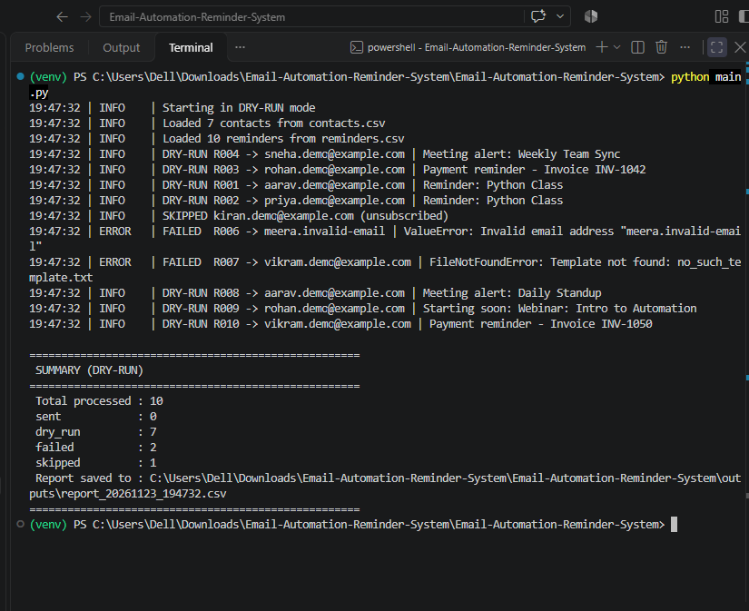
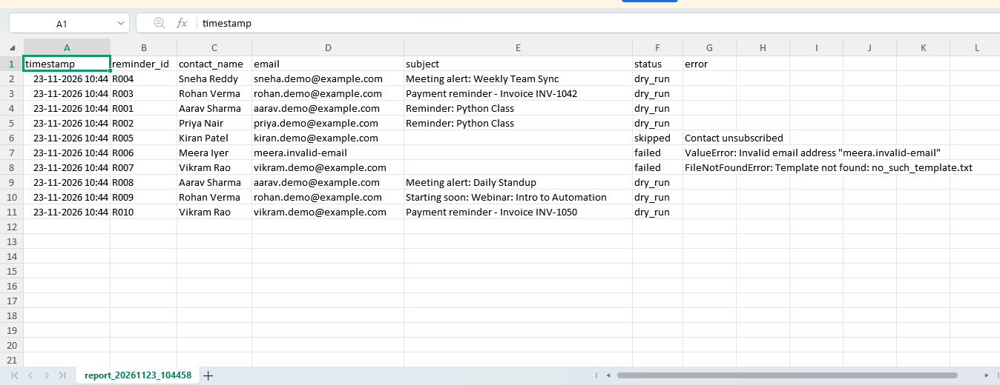

# 📧 Email Automation & Reminder System

A beginner-friendly **Python automation project** that reads contacts and reminders from CSV files, personalises email templates, schedules reminders (one-off, daily, weekly), sends emails over SMTP, and produces logs plus a CSV report. It has a **safe dry-run mode**, so you can test everything without sending a single real email.

## Problem Statement

Teams send the same reminders again and again: class timings, payment dues, meeting alerts, webinar links. Doing it by hand is slow, inconsistent and easy to forget. This project automates the whole cycle and records exactly what happened.

## Industry Relevance

HR (interview/onboarding reminders), Sales (follow-ups), Finance (payment reminders), Operations/Admin (meeting and task alerts), Education (class and deadline nudges). The same pattern (contacts → template → schedule → send → track) powers tools like Mailchimp and HubSpot sequences.

## Features

- CSV contact and reminder import with validation
- Plain-text templates with `$placeholders` (4 templates included)
- One-off, **daily** and **weekly** recurring reminders
- **Dry-run mode (default)**: nothing is sent unless you pass `--live`
- Duplicate-send protection (idempotency keys + ledger in live mode)
- Skips unsubscribed contacts; catches invalid emails and missing templates
- Retry on network errors, rate limit between live sends
- Separate logs: `app.log`, `sent_emails.log`, `failed_emails.log`
- Timestamped CSV report for every run
- Passwords only via environment variables (`.env`, never committed)
- Unit tests

## Tech Stack

Python 3.9+, pandas, smtplib, email.message, datetime, logging, argparse, python-dotenv, unittest

## Folder Structure
```
Email-Automation-Reminder-System/
├── data/          contacts.csv, reminders.csv (dummy data)
├── templates/     email templates (*.txt)
├── src/           config, data_loader, template_engine, mailer, scheduler, engine, reporter, logger_setup
├── outputs/       generated CSV reports
├── logs/          app / sent / failed logs
├── images/        screenshots for this README
├── docs/          guides, architecture, interview prep
├── tests/         unit tests
├── main.py        entry point
├── requirements.txt
├── .env.example
└── .gitignore
```

## Setup
```bash
git clone https://github.com/<your-username>/Email-Automation-Reminder-System.git
cd Email-Automation-Reminder-System

# Windows
python -m venv venv
venv\Scripts\activate
# macOS / Linux
python3 -m venv venv
source venv/bin/activate

pip install -r requirements.txt
```

## Environment Variables (only needed for `--live`)
```bash
cp .env.example .env      # Windows: copy .env.example .env
```
Edit `.env` with your SMTP details. For Gmail, enable 2-Step Verification and create an **App Password**. Never use your normal password, and never commit `.env`.

## How to Run

```bash
python main.py --generate-sample-data     # 1. create dummy data
python main.py                            # 2. dry-run (safe default)
python main.py --watch --duration 40      # 3. scheduler loop (dry-run)
python main.py --live                     # 4. real emails (asks you to type YES)
python -m unittest discover -s tests      # run tests
```

## Sample Output
```
10:44:33 | INFO    | DRY-RUN R001 -> aarav.demo@example.com | Reminder: Python Class
10:44:33 | INFO    | SKIPPED kiran.demo@example.com (unsubscribed)
10:44:33 | ERROR   | FAILED  R006 -> meera.invalid-email | ValueError: Invalid email address "meera.invalid-email"

====================================================
 SUMMARY (DRY-RUN)
====================================================
 Total processed : 10
 dry_run         : 7
 failed          : 2
 skipped         : 1
```

## Screenshots

| | |
|---|---|
|  |  |

## Learning Outcomes

File handling and CSV processing with pandas · modular Python design · SMTP and MIME email · scheduling logic and recurrence · error handling and logging · idempotency · secret management · Git/GitHub workflow

## Future Improvements

HTML emails, attachments/ICS invites, SQLite storage, FastAPI + dashboard, retry queue, open tracking, WhatsApp/SMS, Docker + cloud deployment

> ⚠️ Educational project. All data is dummy. Respect anti-spam laws when emailing real people.

## 👩‍💻 Author

**Yaswitha Kamakshi V.**

B.Tech – Computer Science and Engineering

GitHub: https://github.com/yaswitha-kamakshi

LinkedIn: https://www.linkedin.com/in/yaswitha-kamakshi-292b5242b/

---
